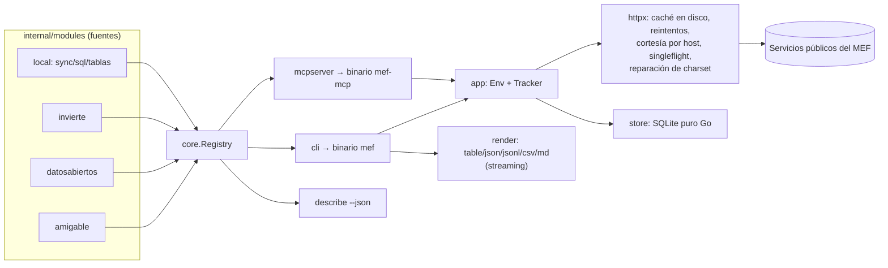

# Arquitectura

## Idea central: una declaración, todas las superficies

Cada comando se declara **una sola vez** como un `core.Command`: su ruta en el CLI, su nombre de tool MCP, parámetros tipados, columnas, prosa y ejemplos. Todo lo demás se *deriva* de esa declaración:

| Superficie | Derivada por | A partir de |
|---|---|---|
| Flags y argumentos del CLI | `internal/cli/leaf.go` | `Params` (tipo, default, enum, positional) |
| JSON Schema de la tool MCP | `core.Command.InputSchema` | `Params` (sin los `CLIOnly`) |
| Validación de entrada | `core.NewInput` | `Params`, **la misma para ambas superficies** |
| Manifiesto `describe --json` | `cli.App.Manifest` | el árbol real de cobra + cada `Command` |
| Tabla/CSV | `render.Writer` | `RowFields` / `Sink.SetColumns` |

Por eso no pueden divergir. Los tests verifican además que cada hoja del parser aparezca en el manifiesto, que cada ejemplo parsee y que cada tool registrada se sirva por MCP.

## Paquetes

| Paquete | Responsabilidad | No hace |
|---|---|---|
| `core` | Contrato: `Command`, `Param`, `Input`, `Sink`, `Result`, `Env`, `Module`, `Registry`, errores y exit codes | E/S |
| `httpx` | Único cliente HTTP: keep-alive, caché, reintentos 429/502/503/504 con backoff, máx. 4 conexiones y 120 ms entre inicios por host, `singleflight`, charset `mixed` | Conocer endpoints |
| `cache` | Caché cross-process en disco (sha256, TTL, escritura atómica); **solo 2xx** | Decidir TTL (lo hace `TTLFor`) |
| `render` | Los cinco formatos; envelope; `Writer` implementa `Sink` con tope `max` y conteo de truncados | Formatear dominio |
| `store` | Apertura SQLite (WAL; `query_only` en lectura), inferencia de tipos segura para códigos con ceros | SQL de negocio |
| `textenc` | Decodificación UTF-8 + Windows-1252 byte a byte | — |
| `app` | Dependencias compartidas y `Tracker` (hace veraz el `cached` del envelope) | — |
| `cli` | Árbol cobra, flags globales, errores y envelope de error, `describe`, `cache`, `doctor` | Lógica de fuentes |
| `mcpserver` | Tools, resources y prompts derivados del registry; errores como `isError` legible | Lógica de fuentes |
| `modules/*` | Una fuente del MEF cada uno | Formatear salida |

## Flujo de una invocación

1. `cli` (o `mcpserver`) localiza el `Command` y arma un `map` crudo de valores.
2. `core.NewInput` coacciona los tipos (strings del CLI o números JSON), aplica defaults y valida enums y rangos.
3. `app.Shared.Env` crea un `core.Env` con un `Tracker` nuevo que envuelve el cliente HTTP.
4. `Command.Run(ctx, env, input, sink)` hace las peticiones y **emite filas** al `Sink` a medida que llegan.
5. En `jsonl`/`csv` cada fila se escribe al instante (memoria constante con `--all`). En `table`/`md`/`json` se bufferiza.
6. `app.Envelope` agrega `meta.module`, `meta.truncated`, `cached` (solo si **todas** las respuestas vinieron de caché) y los datos del `Result`.
7. Los errores pasan por `core.AsError`, que da la clase, el hint y el exit code.

## Decisiones y por qué

- **Go.** Arranque de ~15 ms frente a ~900 ms del CLI Python del arsenal (medido). Un agente invoca el CLI cientos de veces. Binario único, sin runtime, compilación cruzada trivial.
- **SQLite puro Go (`modernc.org/sqlite`).** Sin CGO, así `go install` y la compilación cruzada funcionan en cualquier máquina.
- **Parseo dirigido en vez de DOM.** Consulta Amigable pone los montos **exactos** en el `value` del radio (`COD/PIA/PIM/…`). Leer eso es más rápido y más preciso que parsear las celdas redondeadas.
- **Filtros como ruta ordenada.** En Consulta Amigable el orden de los parámetros es el drill-down. `httpx.OrderedQuery` evita que `url.Values.Encode` lo reordene.
- **Columnas del datastore ordenadas alfabéticamente.** El wrapper Perl emite claves en orden de hash y cambia entre respuestas. Ordenar hace deterministas la salida y el esquema de las tablas sincronizadas.
- **Errores de tool como resultados.** Un `isError` con envelope e `hint` le permite al modelo corregirse. Un error de protocolo no.
- **Tope de 200 filas en MCP.** Protege el contexto del modelo. El hint dirige a `mef_sync` + `mef_sql`.
